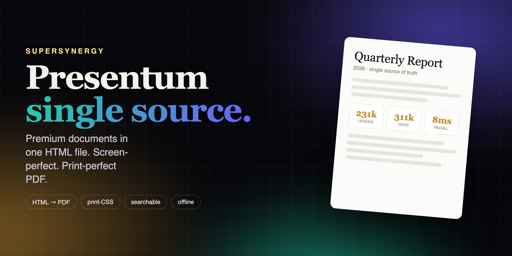
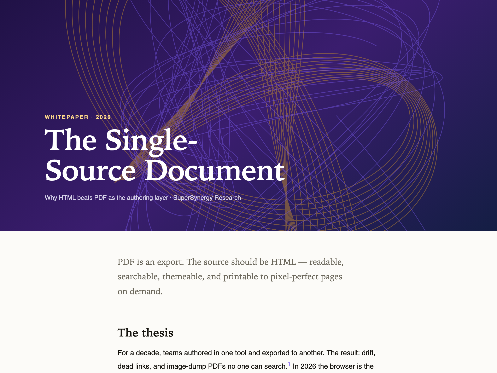
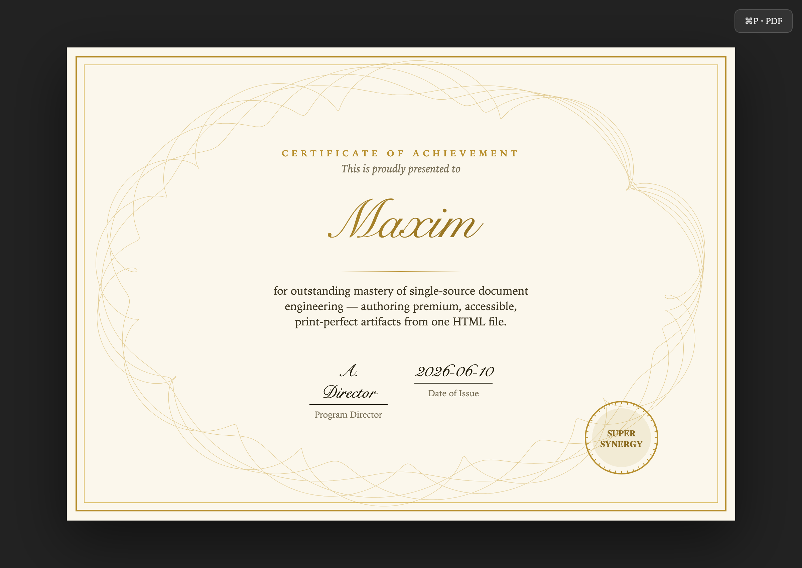
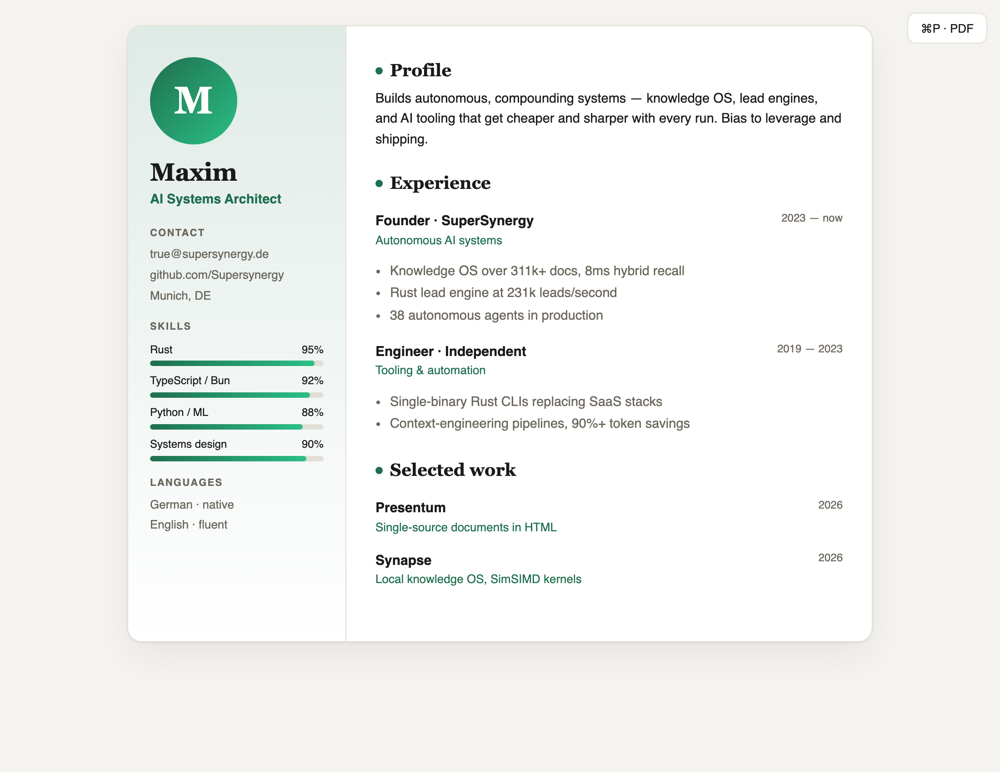
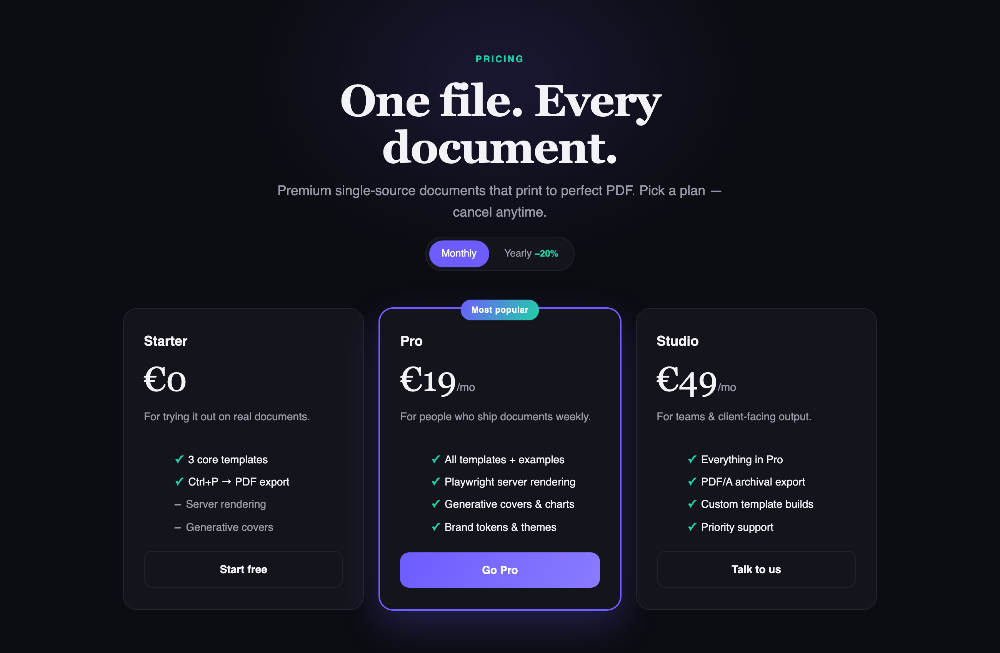

<div align="center">



# Presentum

**Premium documents in one HTML file.** Screen-perfect, prints to pixel-perfect PDF, sent directly.
PDF is an export — not the source.

</div>

---

## Why

The browser is the best layout engine on earth, and it ships everywhere. Author once in HTML and let the reader choose: read it live (search, links, dark-mode, responsive), or print it to a perfect PDF (`⌘P`). One artifact, one source of truth — no more maintaining two copies of everything.

Verified 2026 (Apryse 10-method comparison + code survey): HTML is the best authoring layer. Avoid image exporters (`jsPDF`/`html2canvas` → non-searchable image dump) and dead engines (`wkhtmltopdf` → abandoned 2023, SSRF risk).

## Quick start

```bash
# 1. copy a template
cp templates/document.html ~/Desktop/mein-doc.html
open ~/Desktop/mein-doc.html        # edit + view

# 2a. easiest: ⌘P → "Save as PDF"  (print-CSS already wired)

# 2b. or render server-side — pixel-perfect, searchable text:
bun add -d playwright && bunx playwright install chromium   # one-time
node scripts/render.mjs ~/Desktop/mein-doc.html ~/Desktop/mein-doc.pdf
```

## Examples

Five self-contained, print-ready showcases in [`examples/`](examples/). Each is ONE file — open offline, `⌘P` to PDF.

| | |
|---|---|
| **Investor pitch deck** — animated gradient mesh, count-up metrics, 1 slide/page in print. [`01-pitch-deck.html`](examples/01-pitch-deck.html) |  |
| **Whitepaper** — generative harmonograph cover, embedded static-SVG charts, footnotes, running headers. [`02-whitepaper.html`](examples/02-whitepaper.html) |  |
| **Certificate** — generative guilloché border + seal, gold foil, A4 landscape. [`03-certificate.html`](examples/03-certificate.html) |  |
| **Résumé / CV** — sidebar, animated skill bars, one-page print-perfect. [`04-resume.html`](examples/04-resume.html) |  |
| **Pricing page** — tier cards, monthly/yearly toggle, FOMO badge, gradient glow. [`05-pricing.html`](examples/05-pricing.html) |  |

## Templates

| File | Use |
|---|---|
| [`templates/document.html`](templates/document.html) | Report / proposal — auto-TOC, scroll-spy, dark/light, search, count-up KPIs, full print-CSS |
| [`templates/deck.html`](templates/deck.html) | Slide deck — scroll-snap fullscreen, 1 slide/page landscape in PDF |
| [`templates/invoice.html`](templates/invoice.html) | Invoice / receipt — totals, trust badge, A4 print-CSS |

## What it does

- **One file** — inline CSS/JS, images as `data:` URIs. Opens with no network.
- **Screen**: auto-TOC, scroll-spy, dark/light, in-page search, count-up numbers, timeline trails, keyboard-nav decks.
- **Print** (`@page`): running header + page numbers, clean breaks (`break-inside: avoid`), expanded links, backgrounds preserved.
- **Quality**: searchable/selectable text (never an image), `prefers-reduced-motion` aware, WCAG 2.2 baseline.

## When to send HTML vs PDF

- **Send HTML** when interactive is fine — search, links, dark-mode, phone-responsive; the recipient prints if they want.
- **Export PDF** when pages must be fixed — signing, archival (PDF/A), or the recipient explicitly wants PDF.

## Engine choice (server pipelines)

| Need | Use |
|---|---|
| Node + JS/charts | **Playwright** (`scripts/render.mjs`) |
| Python, no JS | **WeasyPrint** |
| Highest print fidelity + budget | **PrinceXML / DocRaptor** |
| Plain text → PDF, no HTML | **Typst** |

## Scripts

- `scripts/render.mjs in.html out.pdf [--landscape] [--format A4|Letter]` — Playwright HTML→PDF.
- `scripts/shoot.mjs in.html out.png [W] [H] [--full]` — screenshot helper.

## Claude skill

`/presentum` — decision logic, print-CSS essentials, advanced effects, quality bar. Advanced features distilled from `universalui` + `codedesigner` live in [`references/advanced-features.md`](references/advanced-features.md).

## License

MIT © SuperSynergy
