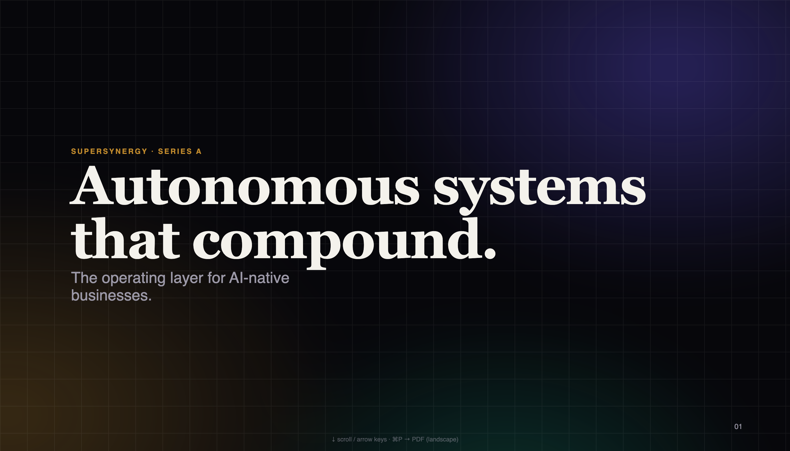

<div align="center">


# Presentum

**Premium documents in one HTML file.** Screen-perfect, prints to pixel-perfect PDF, sent directly.
PDF is an export, not the source.

</div>

[🚀 Quick start](#quick-start) · [🖼️ Examples](#examples) · [📄 Templates](#templates) · [🛠️ Scripts](#scripts) · [License](#license)

---

## Why

Author a document once in HTML. Readers can open it in a browser, follow links and search its text, then export a PDF when fixed pages are needed. Screen and print styles live in the same source file.

Start with a template below. Check page breaks and fonts in print preview before sharing a PDF.

## Quick start

```bash
# 1. copy a template
cp templates/document.html ~/Desktop/mein-doc.html
open ~/Desktop/mein-doc.html        # edit + view

# 2a. easiest: ⌘P → "Save as PDF"  (print-CSS already wired)

# 2b. or render server-side — pixel-perfect, searchable text:
bun add -d playwright && bunx playwright install chromium   # one-time
node scripts/render.mjs ~/Desktop/mein-doc.html ~/Desktop/mein-doc.pdf
```

## Examples

Five self-contained, print-ready showcases in [`examples/`](examples/). Each is ONE file, open offline, `⌘P` to PDF.

### Pitch deck

[Open the pitch deck](examples/01-pitch-deck.html) — animated screen layout with one slide per printed page.



<details>
<summary>🖼️ Explore four more examples</summary>

- [Whitepaper](examples/02-whitepaper.html): SVG charts, footnotes and running headers.
- [Certificate](examples/03-certificate.html): ornamental border and landscape print layout.
- [Résumé](examples/04-resume.html): a sidebar and compact single-page layout.
- [Pricing page](examples/05-pricing.html): tiers and a monthly/yearly toggle.

</details>

## Templates

<details>
<summary><strong>📋 Show 3 entries</strong></summary>

- **[`templates/document.html`](templates/document.html)**<br>
  Use: Report / proposal, auto-TOC, scroll-spy, dark/light, search, count-up KPIs, full print-CSS

- **[`templates/deck.html`](templates/deck.html)**<br>
  Use: Slide deck, scroll-snap fullscreen, 1 slide/page landscape in PDF

- **[`templates/invoice.html`](templates/invoice.html)**<br>
  Use: Invoice / receipt, totals, trust badge, A4 print-CSS

</details>


## What it does

- One file, inline CSS/JS, images as `data:` URIs. Opens with no network.
- Screen: auto-TOC, scroll-spy, dark/light, in-page search, count-up numbers, timeline trails, keyboard-nav decks.
- Print (`@page`): running header + page numbers, clean breaks (`break-inside: avoid`), expanded links, backgrounds preserved.
- Quality: searchable/selectable text (never an image), `prefers-reduced-motion` aware, WCAG 2.2 baseline.

## When to send HTML vs PDF

- Send HTML when interactive is fine, search, links, dark-mode, phone-responsive; the recipient prints if they want.
- Export PDF when pages must be fixed, signing, archival (PDF/A), or the recipient explicitly wants PDF.

## Engine choice (server pipelines)

<details>
<summary><strong>📋 Show 4 entries</strong></summary>

- **Node + JS/charts**<br>
  Use: **Playwright** (`scripts/render.mjs`)

- **Python, no JS**<br>
  Use: **WeasyPrint**

- **Highest print fidelity + budget**<br>
  Use: **PrinceXML / DocRaptor**

- **Plain text → PDF, no HTML**<br>
  Use: **Typst**

</details>


## Scripts

- `scripts/render.mjs in.html out.pdf [--landscape] [--format A4|Letter]`, Playwright HTML→PDF.
- `scripts/shoot.mjs in.html out.png [W] [H] [--full]`, screenshot helper.

## Claude skill

`/presentum`, decision logic, print-CSS essentials, advanced effects, quality bar. Advanced features distilled from `universalui` + `codedesigner` live in [`references/advanced-features.md`](references/advanced-features.md).

## License

MIT © SuperSynergy
